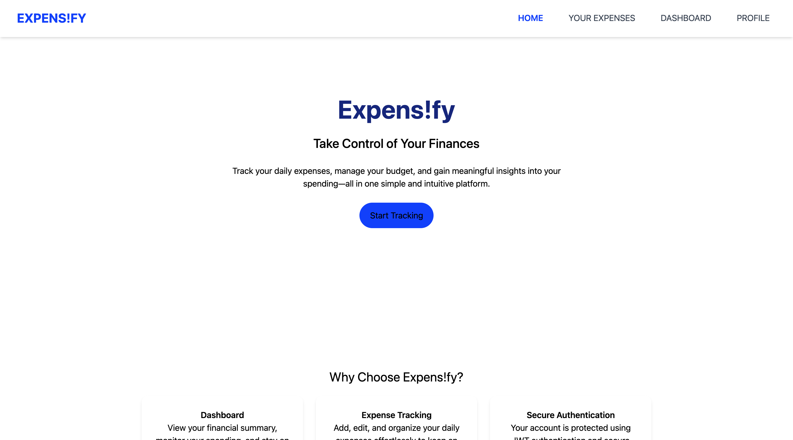
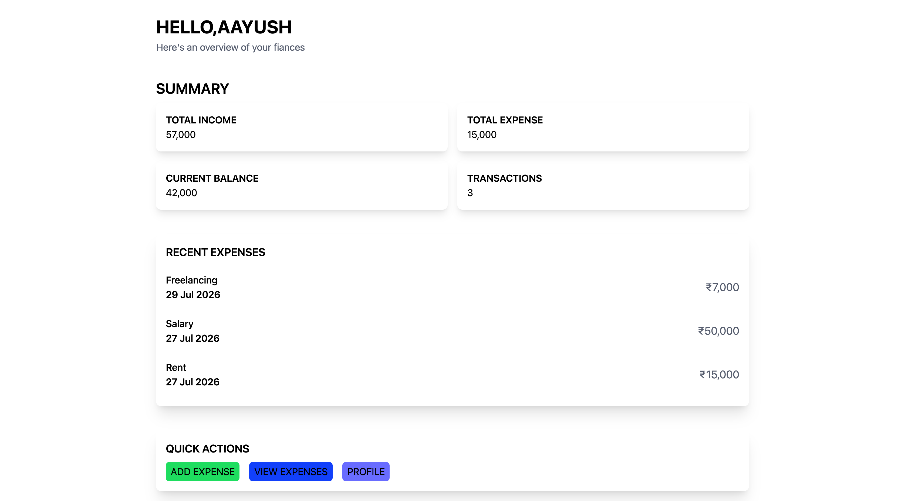
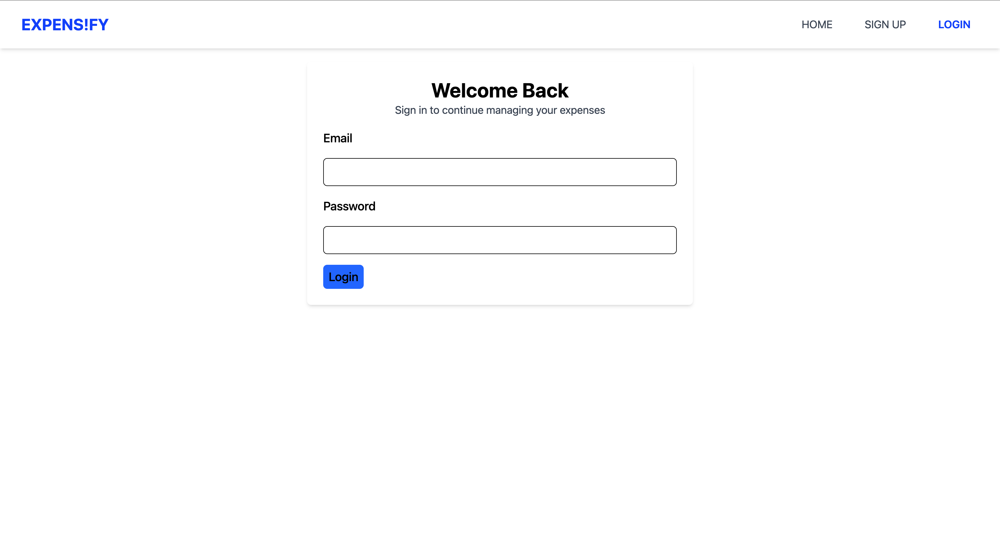
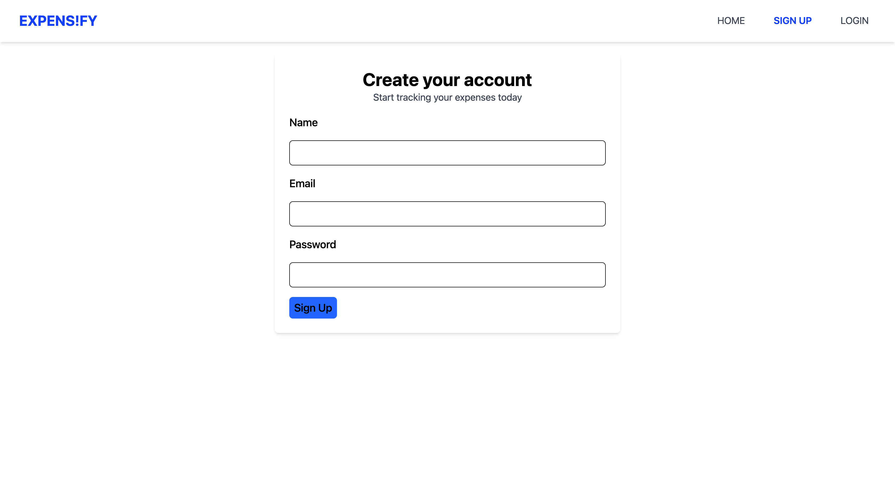

# 💸 Expens!fy

A modern full-stack expense tracker built with the MERN stack that helps users securely manage their personal finances.

---

## 🚀 Live Demo

**Frontend:** https://expensify-ivory.vercel.app

**Backend API:** https://expensify-vkno.onrender.com

---
## 📷 Screenshots


### Home


### Dashboard


### Login


### Sign Up


### Expense List


## ✨ Features

🔐 Secure JWT Authentication  
🍪 HTTP-only Cookie Authentication  
👤 User Registration & Login  
💰 Add Income and Expenses  
✏️ Edit Existing Expenses  
🗑️ Delete Individual Expenses  
🧹 Delete All Expenses  
📊 Dashboard with Financial Summary  
📜 Recent Transactions  
👤 Update User Profile  
🔒 Protected and Public Routes  
🔎 Search Expenses by Description or Category  
🧰 Filter by Type, Category, Date, and Amount  
↕️ Sort by Date and Amount  
🏷️ Custom Categories  
📱 Responsive UI  
🌐 Production Deployment  

## 🛠 Tech Stack

### Frontend

React  
Vite  
React Router  
Tailwind CSS  
TanStack Query  
React Hook Form  
Zod  

### Backend

Node.js  
Express.js  
MongoDB Atlas  
Mongoose  
JWT Authentication  
bcrypt  
Cookie Parser  
CORS  

## 🧠 Concepts Implemented

TanStack Query server-state management  
Query keys and caching  
Query invalidation and refetching  
Mutation loading and error states  
Optimistic updates and rollback handling  
Reusable custom hooks  
Shared API client architecture  
React Hook Form state management  
Zod schema validation  
Protected route architecture  
HTTP-only cookie authentication  
Client-side filtering, searching, and sorting  
Environment-based configuration  
Frontend and backend deployment  

## 📂 Project Structure

```text
EXPENSIFY
│
├── backend
│   ├── controller
│   ├── middleware
│   ├── model
│   ├── route
│   ├── service
│   └── index.js
│
├── frontend
│   ├── src
│   │   ├── components
│   │   ├── constants
│   │   ├── context
│   │   ├── hooks
│   │   ├── layouts
│   │   ├── pages
│   │   ├── routes
│   │   ├── services
│   │   └── utils
│   └── public
│
└── README.md
```

## ⚙️ Installation

### Clone the repository

```bash
git clone https://github.com/kaesh0/EXPENSiFY.git
cd EXPENSiFY
```

### Backend Setup

```bash
cd backend
npm install
```

Create a `.env` file inside the backend directory:

```env
MONGO_URI=your_mongodb_connection_string
JWT_SECRET=your_secret_key
CLIENT_URL=http://localhost:5173
NODE_ENV=development
PORT=3000
```

Run the backend:

```bash
npm run dev
```

### Frontend Setup

Open another terminal:

```bash
cd frontend
npm install
```

Create a `.env` file inside the frontend directory:

```env
VITE_API_URL=http://localhost:3000
```

Run the frontend:

```bash
npm run dev
```

The frontend should now be available at:

```text
http://localhost:5173
```

## 🔒 Authentication

This project uses:

- JWT Authentication
- HTTP-only Cookies
- Protected Backend Routes
- Protected Frontend Routes
- bcrypt Password Hashing
- CORS with Credential Support

## 🌱 Future Improvements

- Redux Toolkit
- TypeScript Migration
- Monthly Analytics
- Charts and Graphs
- Budget Planning
- CSV Export
- Dark Mode
- Improved Mobile Experience
- Automated Testing

## 👨‍💻 Author

Aayush Yadav

GitHub: https://github.com/kaesh0

LinkedIn: https://www.linkedin.com/in/aayush-yadav/